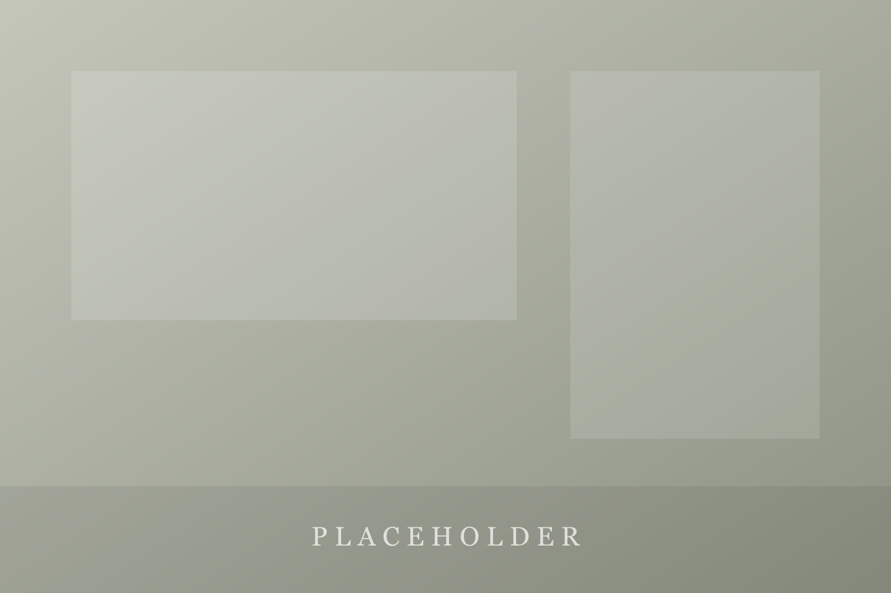

這是一篇測試用的假文章，用來檢查網站字體在各種 Markdown 樣式下的表現。This is a placeholder article for checking how the site fonts render across every Markdown style. 這段是中英混排：我們在 2026 年完成了 Daliao 住宅，面積約 35 坪（about 115 m²），預算 NT$2,800,000。

## 二級標題 Heading Level 2

### 三級標題 Heading Level 3

#### 四級標題 Heading Level 4

##### 五級標題 Heading Level 5

###### 六級標題 Heading Level 6

## 段落 Paragraphs

### 純中文

室內設計不只是把空間變漂亮，而是重新安排生活的動線與節奏。我們從業主每天早上醒來的那一刻開始思考：光線從哪裡進來、咖啡在哪裡煮、鞋子放在哪裡。好的設計會讓人忘記它的存在，只留下舒適的感覺。標點符號測試：「引號」、『雙引號』、《書名號》、（括號）、頓號、分號；冒號：問號？驚嘆號！刪節號……破折號——結束。

### Pure English

Interior design is not just about making a space look good; it is about rearranging the rhythm of daily life. We start from the moment the client wakes up: where the light comes in, where the coffee is made, where the shoes go. Good design disappears and leaves only comfort behind. Punctuation test: "double quotes", 'single quotes', (parentheses), [brackets], semicolon; colon: question? exclamation! ellipsis... em dash — en dash – hyphen-ated.

The quick brown fox jumps over the lazy dog. THE QUICK BROWN FOX JUMPS OVER THE LAZY DOG. 0123456789 !@#$%^&\*()\_+-=

### 中英混排 Mixed

這個 project 的重點是 open kitchen 與 living room 之間的關係。我們用了 Dekton 檯面、Hafele 五金和 Panasonic 的 LED 燈具，色溫設定在 3000K。業主是一位 UX designer，平常在家 work from home，所以書房需要良好的 acoustic 處理。整體風格偏向 Japandi，但加入了一些 mid-century 的元素。

數字與單位：120 cm、2.4 m、45°、80%、3,000 lux、$1,200、2026/10/21、14:30。

## 文字樣式 Inline Styles

- 一般文字 Regular text
- **粗體文字 Bold text**
- _斜體文字 Italic text_
- _**粗斜體 Bold italic**_
- ~~刪除線 Strikethrough~~
- `行內程式碼 inline code`
- [連結文字 Link text](https://ccspace.tw)
- **粗體中混 _斜體_ 與 `code`** — bold with _italic_ and `code` inside
- 句子中間的**粗體**、*斜體*和~~刪除線~~，mid-sentence **bold**, _italic_ and ~~strike~~.

## 清單 Lists

### 無序清單 Unordered

- 客廳 Living room
- 廚房 Kitchen
  - 中島 Island
  - 電器櫃 Appliance cabinet
    - 第三層 Third level
- 主臥 Master bedroom

### 有序清單 Ordered

1. 丈量與訪談 Site survey & interview
2. 平面配置 Space planning
3. 3D 模擬 3D rendering
   1. 材質選擇 Material selection
   2. 燈光計畫 Lighting plan
4. 施工與監工 Construction & supervision
5. 交屋 Handover

### 待辦清單 Task List

- [x] 拆除工程 Demolition
- [x] 水電配管 Plumbing & electrical
- [ ] 木作 Carpentry
- [ ] 油漆 Painting

## 引用 Blockquote

> 少即是多。
>
> Less is more. — Ludwig Mies van der Rohe

> 巢狀引用的第一層，中英混排 first level.
>
> > 第二層 Second level，**粗體** 與 _斜體_。

## 程式碼區塊 Code Block

```css
.font-inconsolata {
  font-family: "Inconsolata", monospace; /* 中文註解 */
}
```

```
純文字區塊 Plain text block
  縮排保留 Indentation preserved
```

## 表格 Table

| 空間 Space   | 坪數 Area | 材質 Material    |  備註 Notes |
| :----------- | :-------: | :--------------- | ----------: |
| 客廳 Living  |    12     | 超耐磨木地板 Oak |    **主要** |
| 廚房 Kitchen |     5     | 石英石 Quartz    |    _開放式_ |
| 主臥 Bedroom |     8     | 塗料 Paint       | `ref: A-01` |

## 分隔線 Horizontal Rule

上方段落 Above.

---

下方段落 Below.

## 圖片 Image



## 註腳 Footnotes

這句話有一個註腳[^1]，這句 also has one[^2]。

[^1]: 這是第一個註腳的內容。

[^2]: This is the second footnote, 中英混排。

## 長段落 Long Paragraph

在設計過程中，我們反覆與業主討論每一個細節，從門把的高度到插座的位置，從窗簾的材質到收納櫃的深度。During the design process we went over every detail with the client, from the height of the door handles to the position of the sockets, from the curtain fabric to the depth of the storage. 這種來回的溝通雖然耗時，卻是讓空間真正符合生活需求的唯一方法。最後完成的住宅，不是設計師的作品集，而是業主生活的容器。A home, in the end, is not the designer's portfolio but a container for the client's life. Supercalifragilisticexpialidocious 是一個很長的單字，用來測試斷行 line-breaking 的行為：https://ccspace.tw/works/a-very-long-url-that-should-wrap-nicely-on-small-screens/
